# 🎥 Portfólio Profissional — Leonardo Noria 👨‍💻

> [!NOTE]
> Portfólio de um desenvolvedor **full stack e mobile** apresentado como uma **sala de controle**: a home é uma "câmera ao vivo" com um detector estilo YOLO que rastreia as skills (e o cursor de quem visita), as páginas são **canais**, os projetos formam uma linha do tempo no formato `git log` e as experiências viram um **log de impacto**. Por trás, um **back-end serverless** de verdade: envio de e-mail, uma IA que responde por mim e dados do GitHub ao vivo.

<table>
  <tr>
    <td width="800px">
      <div align="justify">
        Projeto do <b>Laboratório 01 — Portfólio Profissional</b> da disciplina <i>Desenvolvimento e Integração de Aplicações Web (DIAW)</i> do curso de <b>Engenharia de Software da PUC Minas</b>, orientado pelo <a href="https://github.com/joaopauloaramuni">Prof. Dr. João Paulo Carneiro Aramuni</a>. O site reúne <b>Sobre mim</b> (em <i>português e inglês</i>), <b>Projetos</b> em linha do tempo do mais antigo ao mais recente, <b>Experiências</b> e <b>Contato</b> com formulário que envia e-mail. Hoje trabalho em dois produtos em produção — um app mobile em Flutter com microsserviços em Go na <b>LITS</b> e uma plataforma web em Vue com APIs na <b>Exxata</b> — e a identidade visual vem desse dia a dia: o portfólio "detecta" coisas como uma câmera, mostra logs e roda um back-end próprio.
      </div>
    </td>
    <td>
      <div>
        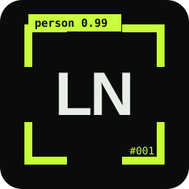
      </div>
    </td>
  </tr>
</table>

---

## 🚧 Status do Projeto

[](https://github.com/norialeo/portfolio-leonardo-noria/actions/workflows/ci.yml)
[](https://github.com/norialeo/portfolio-leonardo-noria/releases)
[](#-licença)


---

## 📚 Índice
- [Links Úteis](#-links-úteis)
- [Sobre o Projeto](#-sobre-o-projeto)
- [Funcionalidades Principais](#-funcionalidades-principais)
- [Tecnologias Utilizadas](#-tecnologias-utilizadas)
  - [Dependências e bibliotecas](#-dependências-e-bibliotecas)
- [Protótipos (Wireframes)](#-protótipos-wireframes)
- [Arquitetura](#-arquitetura)
- [Instalação e Execução](#-instalação-e-execução)
  - [Pré-requisitos](#pré-requisitos)
  - [Variáveis de Ambiente](#-variáveis-de-ambiente)
  - [Instalação de Dependências](#-instalação-de-dependências)
  - [Como Executar a Aplicação](#-como-executar-a-aplicação)
  - [Scripts disponíveis](#-scripts-disponíveis)
- [Deploy](#-deploy)
- [Estrutura de Pastas](#-estrutura-de-pastas)
- [Demonstração](#-demonstração)
- [Testes](#-testes)
- [Processo de Desenvolvimento (Sprints)](#-processo-de-desenvolvimento-sprints)
- [Documentações utilizadas](#-documentações-utilizadas)
- [Autores](#-autores)
- [Contribuição](#-contribuição)
- [Agradecimentos](#-agradecimentos)
- [Licença](#-licença)

---

## 🔗 Links Úteis
* 🌐 **Site publicado:** [leonardonoria.vercel.app](https://leonardonoria.vercel.app)
  > 💻 Hospedado gratuitamente na **Vercel** (front-end estático na CDN + funções serverless em `/api`).
* :octocat: **Repositório:** [github.com/norialeo/portfolio-leonardo-noria](https://github.com/norialeo/portfolio-leonardo-noria)
* 🎨 **Wireframes (Figma / SVG):** [`docs/wireframes`](docs/wireframes) — arquivos SVG vetoriais; arraste para o Figma para editar.
* 📄 **Currículo:** [PT](public/cv/curriculo-leonardo-noria-pt.pdf) · [EN](public/cv/resume-leonardo-noria-en.pdf)

---

## 📝 Sobre o Projeto

**Por que existe.** É a entrega do Lab 01 de DIAW: um portfólio profissional com front-end, back-end e hospedagem na nuvem. Mas eu quis que ele fosse mais do que um currículo em HTML — que ele *mostrasse* como eu trabalho.

**Qual problema resolve.** Recrutadores e colegas veem dezenas de portfólios parecidos. Este aqui comunica em segundos o meu perfil: full stack e mobile, entregando do banco de dados ao app em produtos reais. Tudo que está escrito pode ser verificado — os projetos linkam para o GitHub e a atividade do GitHub aparece ao vivo.

**Contexto.** Acadêmico (PUC Minas, 2º período) e profissional: hoje trabalho em dois produtos em produção (LITS e Exxata), e o site é o meu cartão de visita para os dois mundos.

**O que o torna diferente.**
- 🎯 **Conceito "sala de controle" (inspirado na plataforma de câmeras em que trabalho na Exxata):** a home é um feed de câmera com HUD (REC, FPS, coordenadas de BH) e um detector desenhado em canvas que rastreia as skills como objetos — com caixa, classe, confiança, ID de track e rastro. O visitante também é detectado.
- 🖥️ **Terminal interativo** (`Ctrl/⌘ + K`): `help`, `neofetch`, `ls`, `cd projetos`, `cat curriculo.pdf`, `lang en`, `sudo hire leonardo`… e qualquer pergunta em linguagem natural vai para uma **IA (Gemini) que responde em primeira pessoa** usando só o meu perfil.
- 🧠 **Back-end de verdade:** três funções serverless com validação compartilhada, limite por IP, isca anti-robô, streaming e cache na CDN.

---

## ✨ Funcionalidades Principais

- 👤 **Sobre mim em PT e EN:** formação, área de atuação, interesses e objetivos; troca de idioma instantânea (site inteiro) e lembrada entre visitas. Foto com caixas de detecção (`person`, `face`, `cell phone`).
- 🗂️ **Projetos em linha do tempo dinâmica:** do mais antigo ao mais recente, com nome, descrição, tecnologias, link do repositório, **imagem/GIF do projeto em funcionamento** (galeria + ampliação), filtros por tecnologia com animação e estatísticas ao vivo do GitHub (linguagem, estrelas, último push).
- 💼 **Experiências organizadas:** empresa, cargo, período, modalidade, descrição do produto, métricas, stack e um **log de impacto** filtrável por tipo (`FIX`, `SEC`, `FEAT`, `OPS`, `DATA`, `QA`, `A11Y`, `AI`, `API`).
- ✉️ **Contato:** ícones clicáveis (e-mail, WhatsApp, LinkedIn, GitHub, Instagram, Discord), botão de copiar e **formulário (nome, e-mail, mensagem) que envia e-mail** via função serverless + Resend.
- ✅ **Validações:** mesmo schema Zod no navegador (feedback imediato) e no servidor; contador de caracteres; mensagens traduzidas.
- 🎥 **Home com detector estilo YOLO** em canvas 2D (pausa fora da tela e respeita "reduzir movimento").
- 🌐 **Esfera 3D de tecnologias** (canvas com projeção em perspectiva, arrastável).
- 📡 **GitHub ao vivo:** perfil, repositórios, linguagens e eventos públicos via `/api/github`.
- 🖥️ **Terminal + IA** com respostas em streaming via `/api/ask`.
- 📄 **Currículo em PDF** (PT e EN) para download.
- 📱 **Responsivo** de 360px a telas largas; menu em tela cheia no celular; alvos de toque ≥ 44px.
- ♿ **Acessibilidade:** HTML semântico, link "pular para o conteúdo", foco visível, `aria-*` nos controles, foco levado ao conteúdo na troca de página, `prefers-reduced-motion`.
- 🔍 **SEO/compartilhamento:** título por página, meta description, Open Graph com imagem 1200×630.

---

## 🛠 Tecnologias Utilizadas

### 💻 Front-end

* **Biblioteca:** React 19 (SPA com React Router 8, rotas com *code splitting*)
* **Linguagem:** TypeScript 7 (modo `strict`)
* **Estilização:** CSS Modules + variáveis CSS (design system próprio, sem framework de UI)
* **Animações:** Motion (Framer Motion) — transições de página, *reveal* ao rolar, layout animado dos filtros
* **Gráficos:** Canvas 2D puro (detector da home, esfera de skills, chiado da 404)
* **Formulários:** React Hook Form + Zod
* **Internacionalização:** i18next + react-i18next + detector de idioma
* **Build Tool:** Vite 8

### 🖥️ Back-end

* **Runtime:** Node.js (Vercel Functions) em TypeScript
* **Rotas:** `POST /api/contact`, `POST /api/ask`, `GET /api/github`
* **Validação:** Zod (schema compartilhado com o front-end em `shared/`)
* **Integrações:** Resend (e-mail), Google Gemini (IA com streaming), GitHub REST API
* **Proteções:** limite de requisições por IP, campo isca anti-robô, limite de tamanho do corpo, *timeouts*, escape de HTML

### ⚙️ Infraestrutura & DevOps

* **Cloud:** Vercel (CDN para o front-end + Functions para `/api`)
* **CI:** GitHub Actions (lint → tipos → testes → build a cada push)
* **Qualidade:** Oxlint, Vitest

### 📦 Dependências e bibliotecas

| Pacote | Versão | Para quê |
| :--- | :---: | :--- |
| `react`, `react-dom` | 19.3.0 | Interface |
| `react-router` | 8.4.0 | Páginas, links e rotas sob demanda |
| `motion` | 14.1.0 | Animações e transições |
| `i18next`, `react-i18next`, `i18next-browser-languagedetector` | 26.4.4 · 17.0.16 · 8.2.1 | Português/inglês |
| `react-hook-form` | 7.90.0 | Estado e envio do formulário |
| `zod`, `@hookform/resolvers` | 4.6.6 · 5.9.1 | Validação (navegador e servidor) |
| `react-icons` | 5.7.0 | Ícones (Feather, Font Awesome) |
| `@fontsource-variable/archivo` | 5.3.0 | Fonte de títulos (eixo de largura variável) |
| `@fontsource-variable/jetbrains-mono` | 5.3.0 | Fonte monoespaçada do HUD/terminal |
| `vite`, `@vitejs/plugin-react` | 8.3.4 · 6.1.2 | Dev server e build |
| `typescript` | 7.0.2 | Tipagem |
| `vitest` | 5.0.3 | Testes |
| `oxlint` | 1.87.0 | Lint |
| `sharp` | 0.35.5 | Otimização de imagens/GIFs (`npm run media`) |
| `@types/node`, `@types/react`, `@types/react-dom` | — | Tipos |

---

## 🎨 Protótipos (Wireframes)

Wireframes de **média fidelidade** feitos antes da implementação. Estão em [`docs/wireframes`](docs/wireframes) como **SVG vetorial** — para abrir no Figma, basta arrastar o arquivo para dentro de um arquivo do Figma (vira camadas editáveis).

| Mapa de navegação | Home |
| :---: | :---: |
| 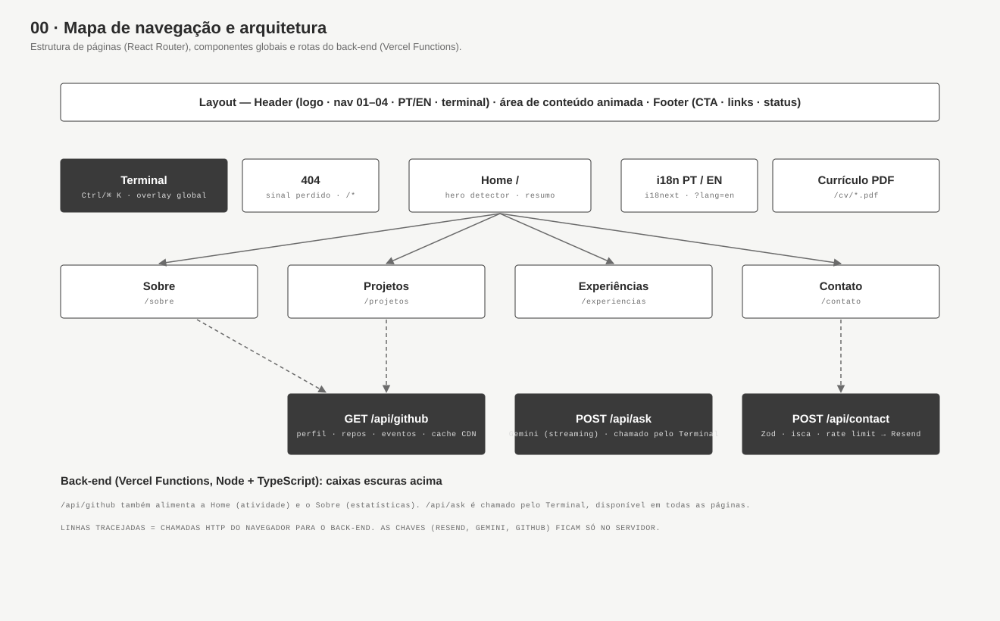 | 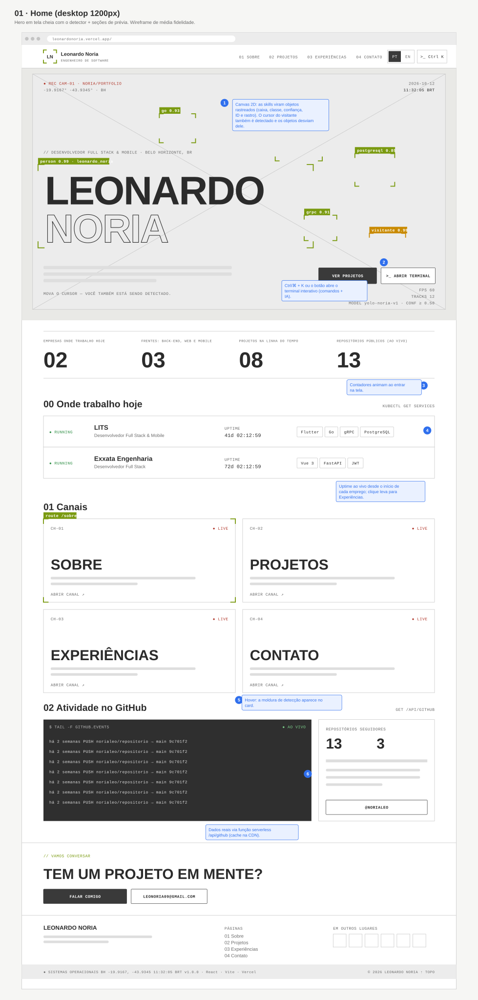 |
| **Sobre mim** | **Projetos** |
| 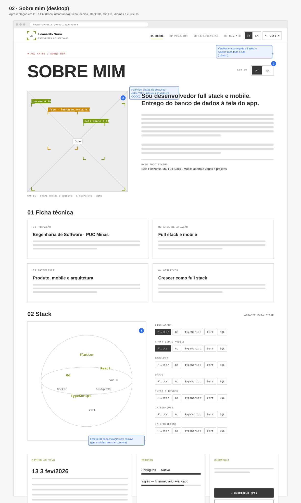 | 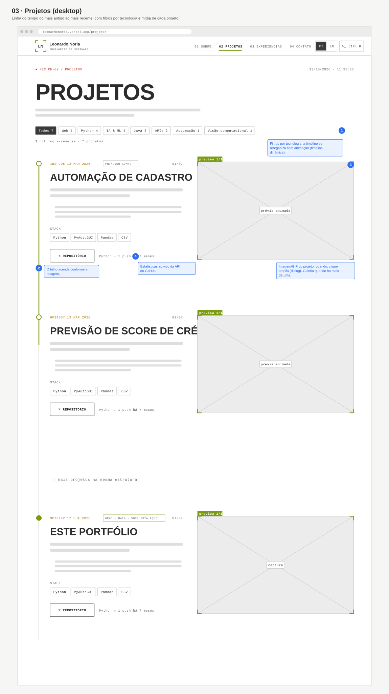 |
| **Experiências** | **Contato** |
| 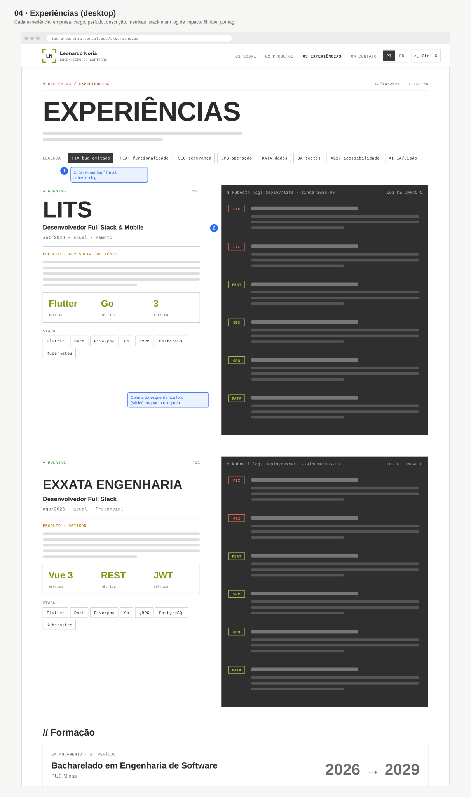 | 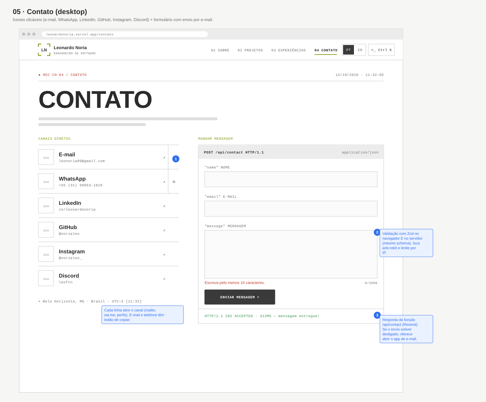 |

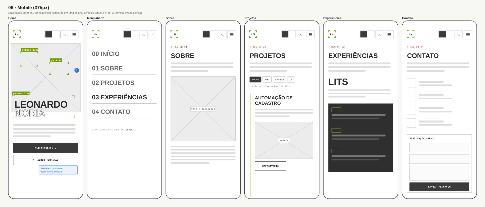

---

## 🏗 Arquitetura

**Visão geral.** Uma SPA React servida como arquivos estáticos pela CDN da Vercel, mais três **Vercel Functions** em `api/`. Não há banco de dados: o conteúdo (projetos, experiências, textos) é **dado tipado** em `src/data/`, versionado junto com o código — trocar um texto é um commit, sem painel administrativo para manter.


**Camadas**

| Camada | Pasta | Papel |
| :--- | :--- | :--- |
| Páginas | `src/pages/` | Uma por rota (`/`, `/sobre`, `/projetos`, `/experiencias`, `/contato`, `*`) |
| Componentes | `src/components/` | Layout (header, footer, transições), UI reutilizável, terminal, peças de cada página |
| Conteúdo | `src/data/` | Perfil, sobre, projetos, experiências e skills com versões `{ pt, en }` |
| Cliente HTTP | `src/lib/api.ts` | Chamadas para `/api/*` (com streaming na IA) |
| Contrato compartilhado | `shared/contact.ts` | Schema Zod usado **no navegador e no servidor** |
| Handlers | `server/` | Lógica das rotas em Node puro (`req`, `res`) — testável sem framework |
| Funções | `api/` | Entradas finas das Vercel Functions que chamam `server/` |

**Decisões importantes**

- **O mesmo código do back-end roda local e na nuvem.** Os handlers ficam em `server/` e recebem `req`/`res` do Node. Em produção, `api/*.ts` os expõe como Vercel Functions; no `npm run dev`, um middleware do Vite (`vite.config.ts`) os serve nas mesmas URLs. Não precisa de dois servidores nem de `vercel dev`.
- **Chaves só no servidor.** `RESEND_API_KEY`, `GEMINI_API_KEY` e `GITHUB_TOKEN` não têm prefixo `VITE_`, então nunca vão para o JavaScript do navegador.
- **Validação dos dois lados com um schema só.** O formulário usa o schema de `shared/contact.ts` para feedback imediato; o servidor usa o mesmo para a validação que vale. Os erros são **códigos** (`name_min`, `email_invalid`…) que o front-end traduz.
- **GitHub com cache na borda.** `/api/github` responde com `s-maxage=1800, stale-while-revalidate`: milhares de visitas viram poucas chamadas à API do GitHub (limite de 60/h sem token). Se o GitHub cair, a função devolve a última cópia em memória.
- **Degradação elegante.** Sem `RESEND_API_KEY`, o formulário oferece abrir o app de e-mail com a mensagem pronta; sem `GEMINI_API_KEY`, o terminal avisa e sugere os comandos que respondem quase tudo.
- **Canvas em vez de biblioteca 3D.** O detector e a esfera de skills são matemática simples em Canvas 2D (pausados fora da tela), o que mantém o bundle leve.
- **Code splitting por rota.** A home vem no pacote principal; Sobre, Projetos, Experiências e Contato são baixados sob demanda.

**Fluxo do formulário de contato**

```text
Navegador                        Vercel Function /api/contact                    Resend
   │  POST { name, email, message, website }                                         │
   │ ─────────────────────────────▶ 1. método e tamanho do corpo                     │
   │                                2. isca preenchida? → 202 (descarta)             │
   │                                3. Zod (mesmo schema do front) → 422 + campos    │
   │                                4. limite por IP (3/min, 10/dia) → 429           │
   │                                5. sem chave → 503 not_configured                │
   │                                6. POST api.resend.com/emails (reply_to=visitante) ─▶
   │ ◀──────────────────────────── 202 { ok, id }  ·  "HTTP/1.1 202 Accepted · 312ms"│
```

**Trade-offs.** O limite por IP vive na memória de cada instância serverless (é um freio contra abuso, não uma garantia distribuída). O conteúdo em arquivos TypeScript exige um deploy para mudar textos — aceitável para um portfólio e mais simples que um CMS.

---

## 🔧 Instalação e Execução

### Pré-requisitos

* **Node.js** 20 ou superior (testado no **24 LTS**) — inclui o `npm`
* **Git**
* (Opcional) Conta gratuita no **Resend** e chave do **Google AI Studio** para ativar e-mail e IA localmente

### 🔑 Variáveis de Ambiente

Todas são **opcionais** para rodar: sem elas o site funciona e cada recurso só avisa que não está configurado. São **secretas** e lidas apenas no servidor (sem prefixo `VITE_`).

| Variável | Descrição | Exemplo |
| :--- | :--- | :--- |
| `RESEND_API_KEY` | Chave da API do [Resend](https://resend.com) para o formulário enviar e-mail | `re_123...` |
| `CONTACT_TO_EMAIL` | Quem recebe as mensagens (padrão: `leonoria09@gmail.com`) | `voce@gmail.com` |
| `CONTACT_FROM` | Remetente (padrão: `onboarding@resend.dev`, funciona sem domínio próprio) | `Portfólio <contato@seudominio.com>` |
| `GEMINI_API_KEY` | Chave do [Google AI Studio](https://aistudio.google.com/apikey) para a IA do terminal | `AIza...` |
| `GEMINI_MODEL` | Modelo do Gemini (padrão: `gemini-3.5-flash-lite`) | `gemini-3.5-flash-lite` |
| `GITHUB_USER` | Usuário do GitHub exibido (padrão: `norialeo`) | `norialeo` |
| `GITHUB_TOKEN` | Token de leitura, só aumenta o limite da API de 60 para 5000 req/h | `github_pat_...` |

Localmente, copie o exemplo e preencha:

```bash
cp .env.example .env.local
```

> 💡 O `vite.config.ts` lê o `.env.local` inteiro no servidor de desenvolvimento, mas só variáveis `VITE_*` chegariam ao navegador — e este projeto não usa nenhuma.

### 📦 Instalação de Dependências

```bash
git clone https://github.com/norialeo/portfolio-leonardo-noria.git
cd portfolio-leonardo-noria
npm install
```

### ⚡ Como Executar a Aplicação

Um terminal só: o Vite serve o front-end **e** as rotas `/api/*` (mesmo código das Vercel Functions).

```bash
npm run dev
```
🚀 *Disponível em **http://localhost:5173** — inclusive `/api/github`, `/api/contact` e `/api/ask`.*

Para testar a versão de produção localmente:

```bash
npm run build
npm run preview
```

### 📜 Scripts disponíveis

| Script | O que faz |
| :--- | :--- |
| `npm run dev` | Servidor de desenvolvimento com hot reload e rotas `/api` |
| `npm run build` | Checagem de tipos + build de produção em `dist/` |
| `npm run preview` | Serve o build de produção (com as rotas `/api`) |
| `npm run lint` | Oxlint |
| `npm run typecheck` | TypeScript sem gerar arquivos |
| `npm test` | Testes com Vitest |
| `npm run media` | Converte PNG/JPG/GIF de `public/projects` e `public/images` para WebP otimizado (GIF vira WebP animado) |

---

## 🚀 Deploy

O deploy é na **Vercel** (plano gratuito), que entende Vite e a pasta `api/` sem configuração extra — o `vercel.json` só ajusta duração das funções, cabeçalhos de segurança/cache e o *rewrite* da SPA.

1. Suba o código para o GitHub (`main`).
2. Em [vercel.com/new](https://vercel.com/new), importe o repositório `portfolio-leonardo-noria` (o *framework preset* "Vite" é detectado sozinho; build `npm run build`, saída `dist`).
3. Em **Settings → Environment Variables**, cadastre `RESEND_API_KEY` e `GEMINI_API_KEY` (e as opcionais da tabela acima).
4. Clique em **Deploy**. Cada push na `main` gera um deploy de produção; cada PR gera um **Preview Deployment** com URL própria.

```text
Vercel
├── CDN ............ dist/ (HTML, JS, CSS, fontes, imagens) — cache imutável em /assets
└── Functions ...... api/contact.ts · api/ask.ts · api/github.ts (Node.js)
```

> [!IMPORTANT]
> O GitHub Pages **não** serve para este projeto: ele hospeda só arquivos estáticos, e o formulário, a IA e o GitHub ao vivo dependem das funções em `api/`.

---

## 📂 Estrutura de Pastas

```
.
├── .env.example                 # 🧩 Variáveis de ambiente (sem valores)
├── .github/workflows/ci.yml     # 🤖 CI: lint, tipos, testes e build
├── api/                         # ☁️ Vercel Functions (entradas finas)
│   ├── ask.ts                   #    POST /api/ask     → server/ask.ts
│   ├── contact.ts               #    POST /api/contact → server/contact.ts
│   └── github.ts                #    GET  /api/github  → server/github.ts
├── server/                      # ⚙️ Lógica do back-end (Node puro, testável)
│   ├── ask.ts                   #    IA (Gemini) com streaming e limite por IP
│   ├── contact.ts               #    Validação + envio de e-mail (Resend)
│   ├── github.ts                #    Perfil, repositórios, linguagens e eventos
│   ├── http.ts                  #    Respostas JSON, leitura do corpo, rate limiter
│   ├── profile.ts               #    O que a IA sabe sobre mim
│   └── routes.ts                #    Mapa rota → handler (usado pelo Vite no dev)
├── shared/
│   └── contact.ts               # 🤝 Schema Zod usado no navegador e no servidor
├── src/
│   ├── main.tsx · router.tsx    # 🚪 Entrada e rotas (code splitting)
│   ├── components/
│   │   ├── layout/              # 🧱 Header, Footer, Layout (transições), seletor de idioma
│   │   ├── ui/                  # 🧩 Detection (moldura), PageHeader, Reveal, SectionTitle
│   │   ├── home/                # 🎥 Detector (canvas), Hero/HUD, métricas, canais, GitHub
│   │   ├── about/               # 👤 Foto com detecções, esfera de skills
│   │   ├── projects/            # 🖼️ MediaViewer (galeria + ampliação)
│   │   ├── contact/             # ✉️ Formulário "requisição HTTP"
│   │   └── terminal/            # 🖥️ Terminal, comandos e contexto global
│   ├── data/                    # 📚 Conteúdo tipado em PT/EN (perfil, projetos, experiências…)
│   ├── hooks/                   # 🎣 useLang, useGitHub, useNow, useDocumentTitle
│   ├── i18n/                    # 🌎 Configuração e textos da interface (pt.json, en.json)
│   ├── lib/                     # 🛠️ Cliente da API, formatação, navegação, redes sociais
│   ├── pages/                   # 📄 Home, Sobre, Projetos, Experiências, Contato, 404
│   └── styles/global.css        # 🎨 Tokens de cor, tipografia e utilitários
├── public/
│   ├── cv/                      # 📄 Currículos PT e EN
│   ├── images/                  # 🖼️ Foto
│   ├── projects/<slug>/         # 🎞️ Capturas e prévias animadas de cada projeto
│   └── favicon.svg · og-image.png · apple-touch-icon.png
├── scripts/optimize-media.mjs   # 🗜️ Converte imagens/GIFs para WebP
├── tests/                       # 🧪 Testes do back-end (Vitest)
├── docs/
│   ├── wireframes/              # 🎨 Wireframes de média fidelidade (SVG → Figma)
│   ├── screenshots/             # 📸 Capturas usadas neste README
│   └── logo.svg
├── index.html · vite.config.ts · tsconfig.json · vercel.json · package.json
├── LICENSE
└── README.md
```

---

## 🎥 Demonstração

### 🌐 Aplicação Web

| Home — detector ao vivo | Sobre mim (PT) |
| :---: | :---: |
| 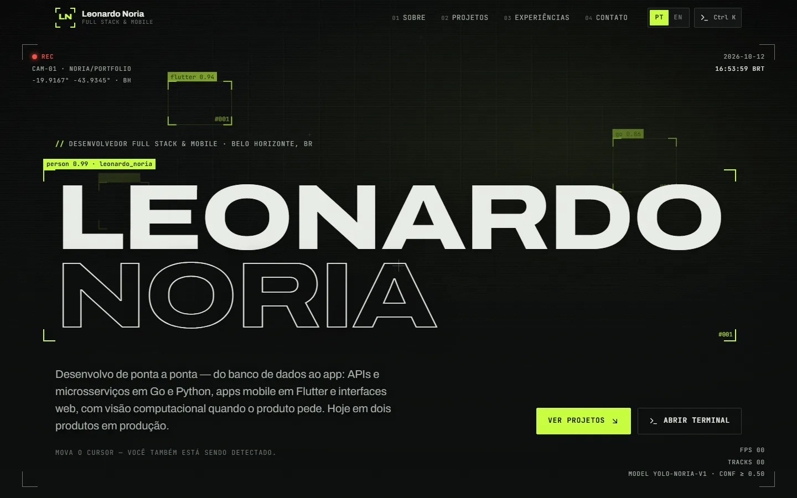 | 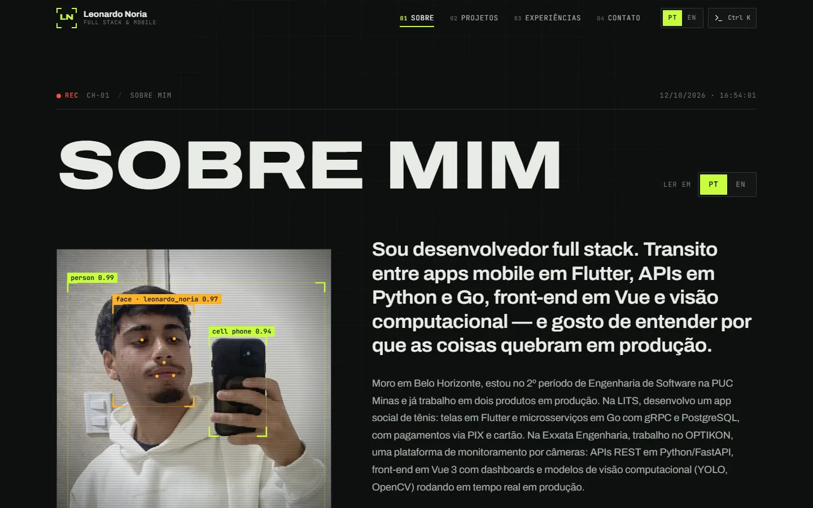 |
| **About me (EN)** | **Projetos — linha do tempo** |
| 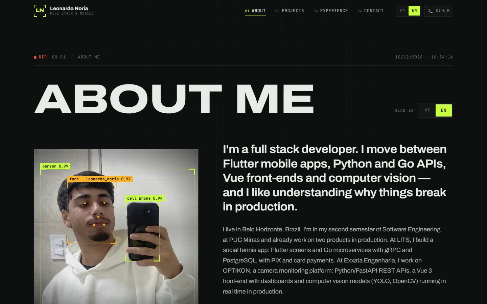 | 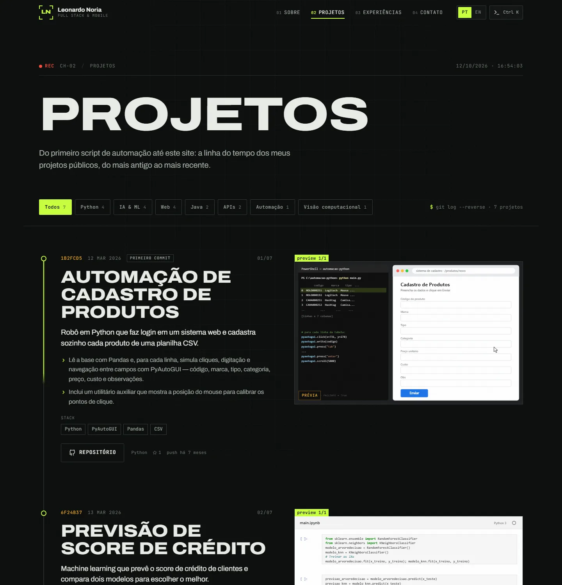 |
| **Experiências — log de impacto** | **Contato — formulário** |
| 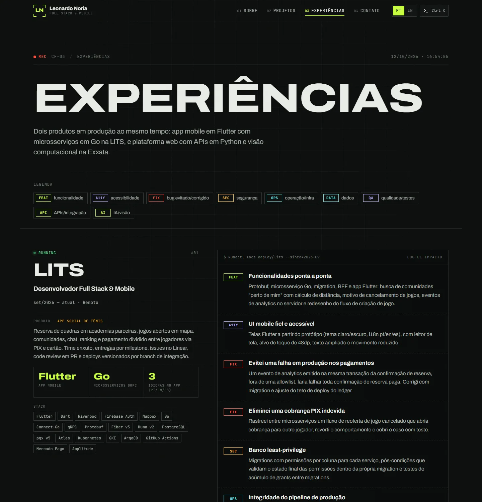 | 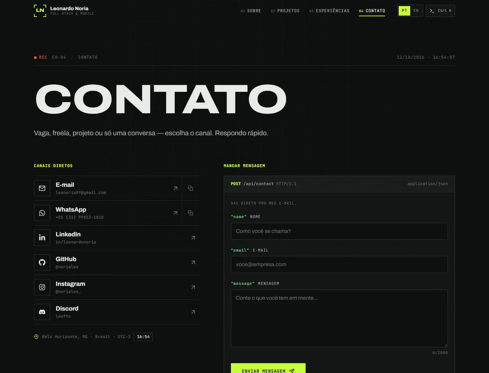 |

### 📱 Mobile

| Home | Sobre | Projetos | Contato |
| :---: | :---: | :---: | :---: |
| 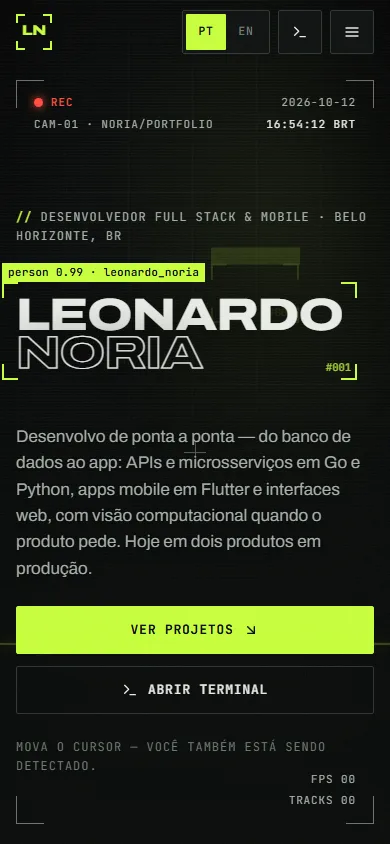 |  |  |  |

### 🎞️ Projetos em funcionamento

Cada projeto da linha do tempo tem mídia própria em `public/projects/<slug>/`. **Candidatos TSE** usa capturas reais. Os demais usam **prévias animadas em SVG reconstruídas a partir do código de cada repositório** (marcadas como "prévia" no site) — para trocar por uma gravação real, salve o GIF na pasta do projeto, rode `npm run media` e atualize `src/data/projects.ts`.

| Automação de cadastro | Score de crédito (ML) | Chatbot com IA |
| :---: | :---: | :---: |
|  |  |  |
| **HandVision** | **API de Clima** | **Candidatos TSE** |
|  |  | 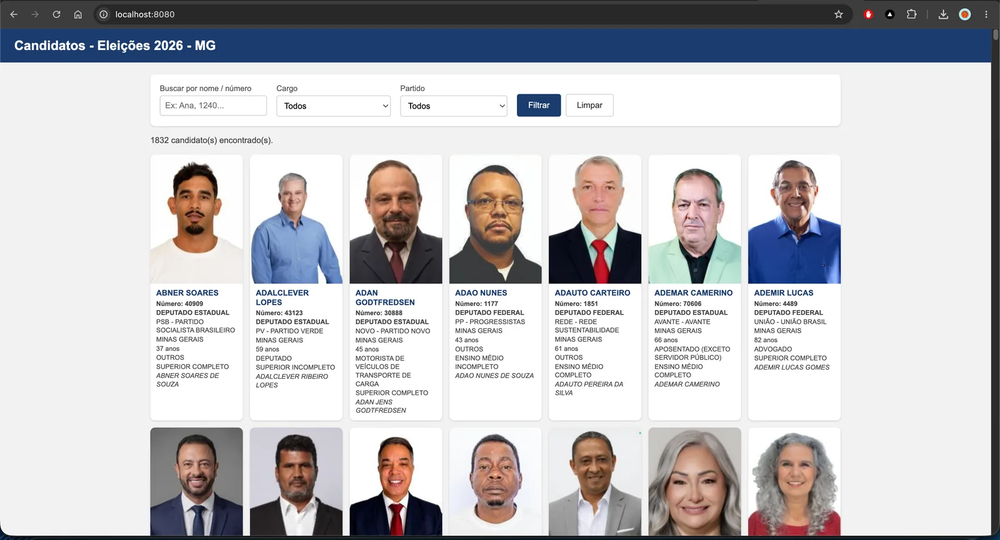 |

### 💻 Exemplo de saída no Terminal (API)

#### 1. GitHub ao vivo

```bash
curl -s http://localhost:5173/api/github | jq '.profile, .languages'
```

**Saída esperada (resumida):**
```json
{
  "login": "norialeo",
  "name": "Leonardo Noria",
  "location": "Belo Horizonte",
  "followers": 3,
  "publicRepos": 13
}
[
  { "name": "Python", "repos": 5, "share": 0.46 },
  { "name": "Java", "repos": 4, "share": 0.37 },
  { "name": "Jupyter Notebook", "repos": 1, "share": 0.17 }
]
```

#### 2. Formulário de contato

```bash
curl -i -X POST http://localhost:5173/api/contact \
     -H 'Content-Type: application/json' \
     -d '{"name":"A","email":"x","message":"oi"}'
```

**Saída esperada:**
```text
HTTP/1.1 422 Unprocessable Entity
Content-Type: application/json; charset=utf-8

{"error":"validation","message":"Confira os campos.","fields":{"name":"name_min","email":"email_invalid","message":"message_min"}}
```

#### 3. Terminal do site (`Ctrl/⌘ + K`)

```text
noria@portfolio:~$ neofetch
┌─┐    ┌─┐    noria@portfolio
│ L    N │    ───────────────
│        │    OS: Belo Horizonte, MG · BR
└─┘    └─┘    Host: PUC Minas · Eng. de Software (2º período)
              Kernel: Flutter · Go · TypeScript
              Services: LITS (app Flutter + Go) · Exxata (Vue 3 + APIs)
noria@portfolio:~$ o que você faz na exxata?        # com GEMINI_API_KEY configurada
leonardo.ai  Na Exxata eu trabalho no OPTIKON, uma plataforma web em Vue 3 com APIs em FastAPI…
```

---

## 🧪 Testes

### Testes unitários e de integração do back-end

```bash
npm test
```

*Ferramenta: **Vitest**.* Os testes (`tests/`) chamam os handlers reais com requisições simuladas e cobrem:

- schema de contato (dados válidos, espaços, códigos de erro, limite de tamanho);
- `POST /api/contact`: método inválido (405), JSON quebrado (400), campos inválidos (422 com códigos), isca anti-robô (202 sem enviar), sem chave (503), envio pelo Resend com `reply_to` correto, **escape de HTML** na mensagem, falha do provedor (502) e **limite por IP** (429 na 4ª mensagem);
- agregação do GitHub (ignora forks, ordena por push, calcula participação das linguagens, resume eventos);
- IA: nova tentativa quando o Gemini está sobrecarregado (500/503), troca para o modelo reserva e não troca em erro de cota/chave;
- rate limiter (janela deslizante).

```text
 ✓ tests/ask.test.ts (5 tests)
 ✓ tests/github.test.ts (4 tests)
 ✓ tests/contact.test.ts (12 tests)
 Test Files  3 passed (3)
      Tests  21 passed (21)
```

A **CI** (`.github/workflows/ci.yml`) roda lint, tipos, testes e build em cada push e PR.

---

## 🗓 Processo de Desenvolvimento (Sprints)

### ✅ Lab01S01 — Planejamento e prototipação
- [x] Repositório GitHub com README
- [x] Wireframes de média fidelidade das páginas ([`docs/wireframes`](docs/wireframes), importáveis no Figma)
- [x] Protótipo do front-end em React + TypeScript
- [x] Navegação (React Router: páginas e links entre seções) e layout principal (cabeçalho, rodapé e área de conteúdo)

### ✅ Lab01S02 — Funcionalidades principais
- [x] Página **Sobre mim** com versões em português e inglês
- [x] Página **Projetos** com linha do tempo dinâmica (filtros animados, trilho que acende na rolagem, dados ao vivo)
- [x] Página **Experiências** com dados organizados (empresa, cargo, período, descrição, métricas, stack)
- [x] Página **Contato** com ícones e formulário funcional (envio de e-mail)
- [x] Validações (Zod no navegador e no servidor) e responsividade

### ✅ Lab01S03 — Hospedagem e finalização
- [x] Configuração de deploy na Vercel (`vercel.json`, funções em `api/`)
- [x] Ajustes visuais e de usabilidade (mobile, acessibilidade, movimento reduzido)
- [x] Imagens/GIFs dos projetos em execução
- [x] README final com tecnologias, link do site e instruções de uso e desenvolvimento

---

## 🔗 Documentações utilizadas

* 📖 [**React**](https://react.dev/reference/react) · [**React Router**](https://reactrouter.com/)
* 📖 [**Vite**](https://vite.dev/config/) — inclusive `configureServer` para servir `/api` no dev
* 📖 [**Vercel Functions**](https://vercel.com/docs/functions) · [**vercel.json**](https://vercel.com/docs/project-configuration)
* 📖 [**Motion**](https://motion.dev/) · [**i18next**](https://www.i18next.com/) · [**react-i18next**](https://react.i18next.com/)
* 📖 [**React Hook Form**](https://react-hook-form.com/) · [**Zod**](https://zod.dev/)
* 📖 [**Resend API**](https://resend.com/docs/api-reference/emails/send-email) · [**Gemini API**](https://ai.google.dev/gemini-api/docs) · [**GitHub REST API**](https://docs.github.com/rest)
* 📖 [**Vitest**](https://vitest.dev/) · [**Oxlint**](https://oxc.rs/docs/guide/usage/linter)
* 📖 Projetos de referência do professor: [GeminiAPI](https://github.com/joaopauloaramuni/desenvolvimento-e-integracao-de-aplicacoes-web/tree/main/PROJETOS/React/GeminiAPI), [GitHubAPI](https://github.com/joaopauloaramuni/desenvolvimento-e-integracao-de-aplicacoes-web/tree/main/PROJETOS/React/GitHubAPI), [SkillsGlobe](https://github.com/joaopauloaramuni/desenvolvimento-e-integracao-de-aplicacoes-web/tree/main/PROJETOS/React/SkillsGlobe), [CurriculumPDF](https://github.com/joaopauloaramuni/desenvolvimento-e-integracao-de-aplicacoes-web/tree/main/PROJETOS/React/CurriculumPDF), [Internacionalizacao_i18n](https://github.com/joaopauloaramuni/desenvolvimento-e-integracao-de-aplicacoes-web/tree/main/PROJETOS/React/Internacionalizacao_i18n)
* 📖 [**Conventional Commits**](https://www.conventionalcommits.org/en/v1.0.0/)

---

## 👥 Autores

| 👤 Nome | 🖼️ Foto | :octocat: GitHub | 💼 LinkedIn | 📤 Gmail |
|---------|----------|-----------------|-------------|-----------|
| Leonardo Noria | <div align="center"></div> | <div align="center"><a href="https://github.com/norialeo"></a></div> | <div align="center"><a href="https://www.linkedin.com/in/leonardonoria/"></a></div> | <div align="center"><a href="mailto:leonoria09@gmail.com"></a></div> |

---

## 🤝 Contribuição

1. Faça um `fork` do projeto.
2. Crie uma branch (`git checkout -b feat/minha-feature`).
3. Faça commits seguindo [Conventional Commits](https://www.conventionalcommits.org/en/v1.0.0/) (`git commit -m "feat: adiciona X"`).
4. Garanta que `npm run lint`, `npm run typecheck` e `npm test` passam.
5. Faça o `push` e abra um **Pull Request** — a Vercel gera um preview automático.

---

## 🙏 Agradecimentos

* [**Engenharia de Software PUC Minas**](https://www.instagram.com/engsoftwarepucminas/) — pela estrutura acadêmica e pelo incentivo a boas práticas.
* [**Prof. Dr. João Paulo Aramuni**](https://github.com/joaopauloaramuni) — pelo laboratório, pelo template deste README e pelos projetos de referência de integração com APIs.
* Equipes da **LITS** e da **Exxata Engenharia** — pelo dia a dia em produção que inspirou a identidade deste site.

---

## 📄 Licença

Este projeto é distribuído sob a **[Licença MIT](LICENSE)**.

---
